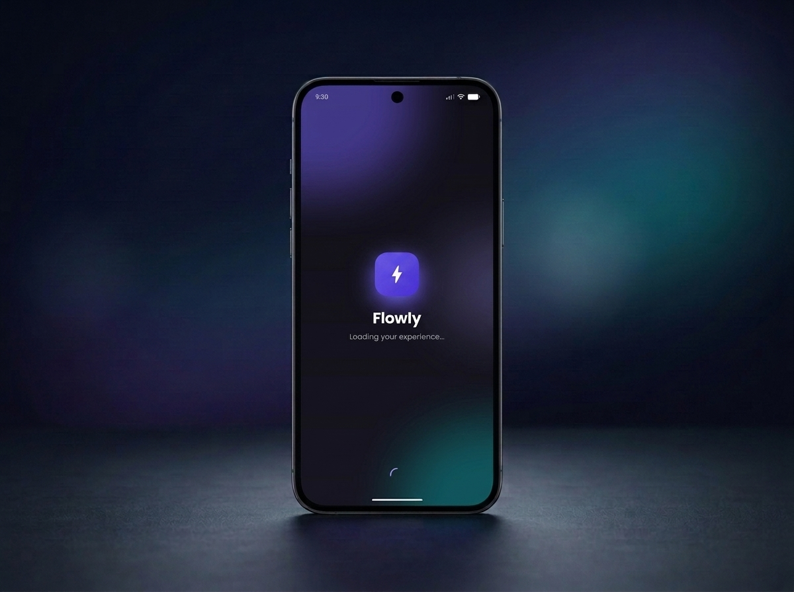
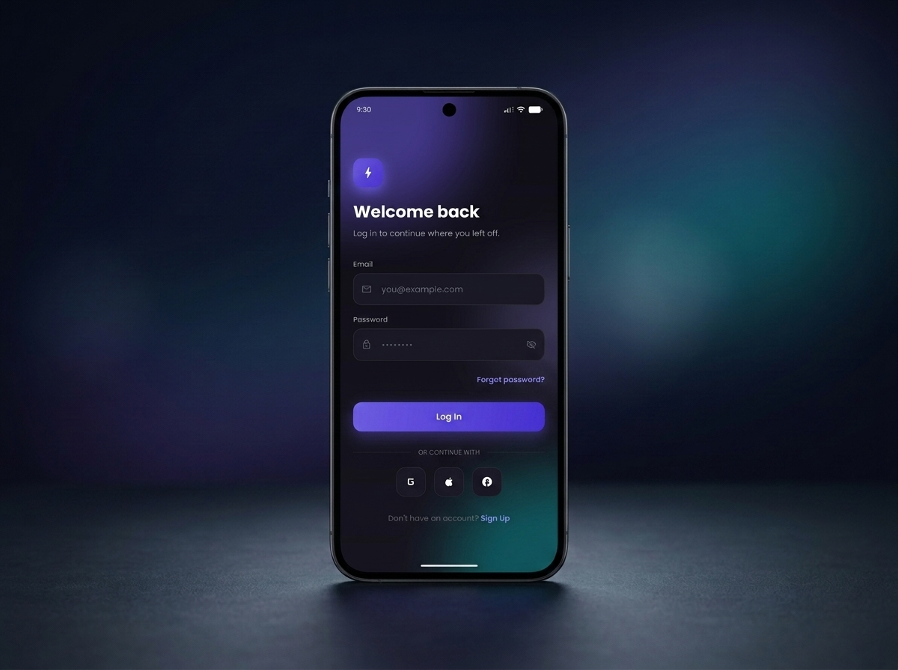
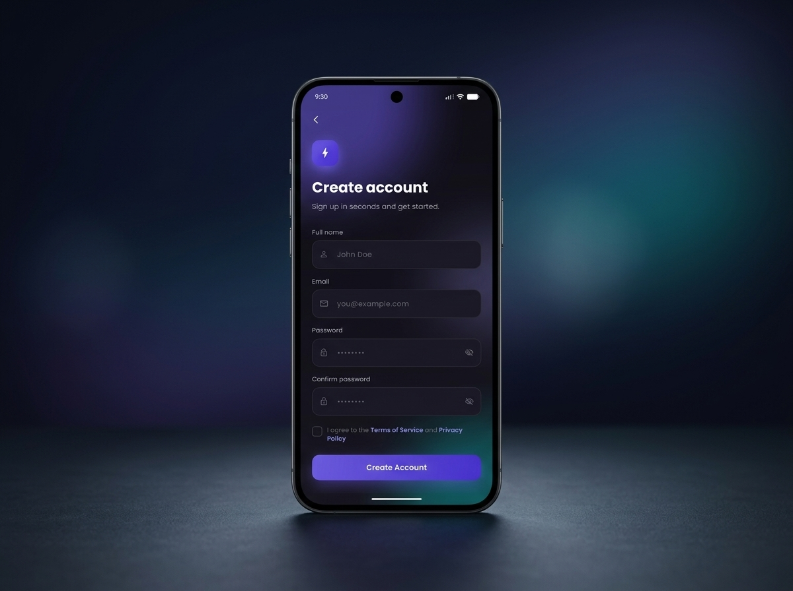

# glassmorphic_auth_flutter

A Flutter authentication flow with a modern glassmorphic UI: animated gradients, blurred blob backgrounds, staggered entrance animations, and polished login/sign-up screens.

Built with clean module separation, GoRouter navigation, and Google Fonts (Poppins) — no backend, purely a front-end UI kit.

<div align="center">
  
  
  
</div>

<p align="center"><em>Splash → Log in → Sign up</em></p>

---

## Features

- **Glassmorphic design** — blurred surfaces, translucent borders, and soft shadows on dark theme
- **Animated blob background** — drifting, gradient blobs with a backdrop blur for depth
- **Staggered entrance animations** — fade + slide sequences on every screen
- **Splash screen** — animated logo with elastic-out scale and fade-in text
- **Login screen** — email/password form with toggle visibility, "Forgot password?", social login row, and sign-up link
- **Sign-up screen** — name, email, password, confirm password, terms checkbox, social login row, and log-in link
- **Reusable widgets** — `AuthHeader`, `AuthTextField`, `GradientButton`, `SocialLoginRow`, `AnimatedCheckboxRow`, `StaggeredFadeSlide`
- **Navigation** — GoRouter with named routes (`/splash`, `/login`, `/signup`)
- **Dark theme** — custom color palette tuned for glassmorphism (deep zinc base, violet/primary accents, teal accent)

---

## Screenshots

The app bundles preview images in `assets/images/`:

| File | Purpose |
|------|---------|
| `assets/images/splash.jpg` | Splash/onboarding screen |
| `assets/images/login.jpg` | Log-in screen |
| `assets/images/register.jpg` | Sign-up screen |

---

## Getting Started

### Prerequisites

- [Flutter SDK](https://docs.flutter.dev/get-started/install) (3.12.2+)
- An editor (VS Code, Android Studio, IntelliJ, or Emacs)
- A device or emulator (iOS/Android/Web)

### Install dependencies

```bash
flutter pub get
```

### Run the app

```bash
flutter run
```

### Build for release

```bash
# Android APK
flutter build apk --release

# Android App Bundle
flutter build appbundle --release

# iOS
flutter build ios --release

# Web
flutter build web --release
```

### Analyze & test

```bash
flutter analyze
flutter test
```

---

## Project Structure

```
lib/
├── main.dart                      # App entry point + theme
├── common/
│   ├── app_colors.dart            # Glassmorphic color palette + gradients
│   └── app_text_styles.dart       # Poppins-based text styles
├── routes/
│   └── app_router.dart            # GoRouter route definitions
├── modules/
│   ├── splash_module/
│   │   └── views/splash_view.dart # Animated splash screen
│   └── auth_module/
│       ├── views/
│       │   ├── login_view.dart    # Log-in screen
│       │   └── signup_view.dart   # Sign-up screen
│       └── widgets/
│           ├── auth_header.dart           # Title + icon header
│           ├── auth_text_field.dart       # Glass input field w/ reveal
│           ├── gradient_button.dart       # Gradient primary button
│           ├── social_login_row.dart      # Google / Apple / Facebook
│           ├── animated_checkbox_row.dart # Terms checkbox
│           ├── staggered_fade_slide.dart  # Entrance animation helper
│           └── animated_blob_background.dart  # Drifting blurred blobs
```

### Route map

| Route | Widget | Purpose |
|-------|--------|---------|
| `/splash` | `SplashView` | Animated splash, auto-navigates to login |
| `/login` | `LoginView` | Log-in form |
| `/signup` | `SignUpView` | Registration form |

---

## Tech Stack

- **Flutter** — UI toolkit (stable channel)
- **go_router** (`^17.3.0`) — declarative routing
- **google_fonts** (`^8.2.0`) — Poppins typeface
- **cupertino_icons** (`^1.0.8`) — iOS-style icons

See [`pubspec.yaml`](pubspec.yaml) for the full dependency list.

---

## Customizing

### Colors

Edit [`lib/common/app_colors.dart`](lib/common/app_colors.dart) to rebrand the palette:

```dart
static const Color primary = Color(0xFF6C5CE7);   // violet
static const Color accent = Color(0xFF00D2D3);    // teal
```

### Fonts

Edit [`lib/common/app_text_styles.dart`](lib/common/app_text_styles.dart) to swap Poppins for another Google Font.

### Routes

Edit [`lib/routes/app_router.dart`](lib/routes/app_router.dart) to add screens or rename paths.

---

## License

This project is open source and available under the [MIT License](LICENSE).

---

Made with Flutter ❤️ — glassmorphic auth UI by Maaz Khan.
